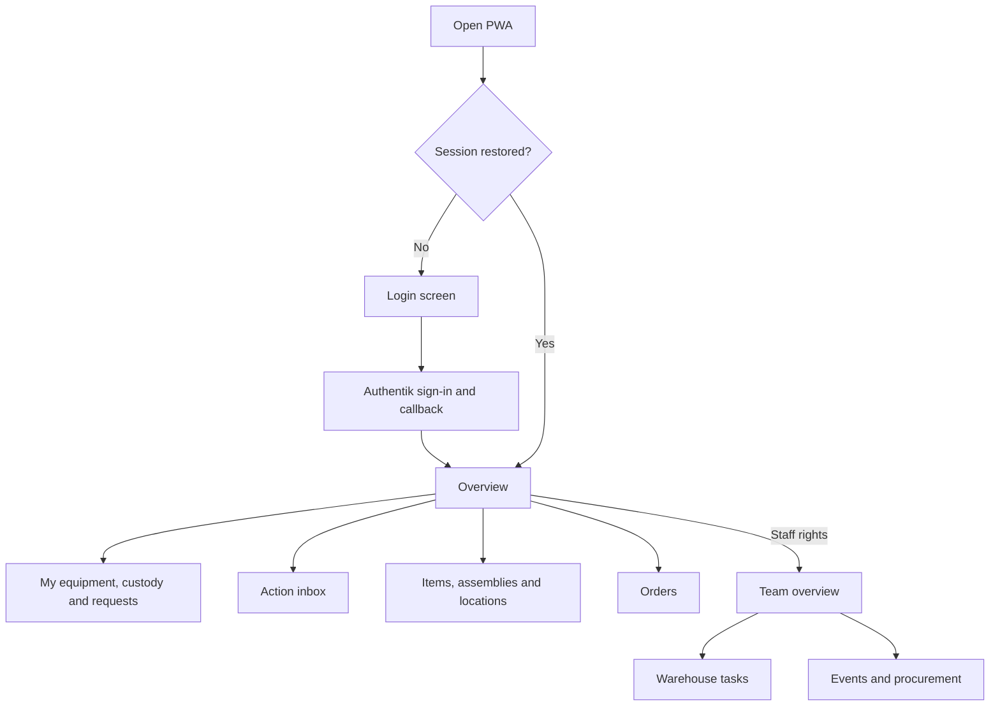
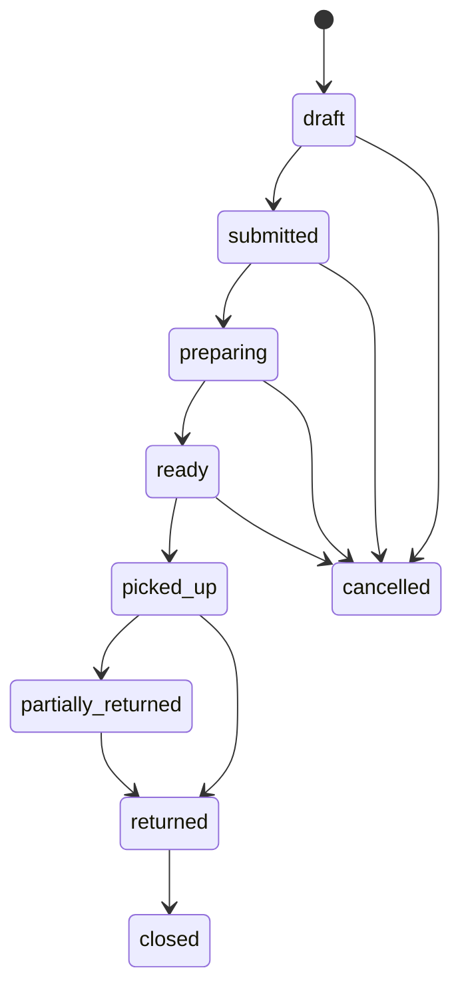
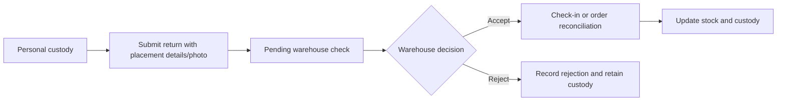

# App Flow

This document owns navigation, user journeys and workflow states. Feature requirements are in [Product Requirements](PRODUCT_REQUIREMENTS.md), UI presentation in [Design Brief](DESIGN_BRIEF.md), and transport/security details in [Technical Requirements](TECHNICAL_REQUIREMENTS.md).

## 1. Entry and navigation

There is no standalone `/login` route: unauthenticated App content renders `LoginPage`. Initial sign-in needs connectivity. A stored account session allows cached offline use; online API access still needs a valid token. Signed-in users land on `/`, initially the personal overview. Staff can select team scope using `/?scope=team`.

The desktop shell uses grouped drawer navigation. Mobile uses Home, Inventory (when available), Orders, Tasks and More. Tasks opens the inbox dialog; More opens the drawer. The header provides global context, session controls and sync status. Logout clears the active session/cache context and coordinates other tabs.

## 2. Route inventory

Source: [App.tsx](../src/App.tsx), [access guards](../src/components/shared/AccessGuard.tsx), [access helpers](../src/utils/access.ts), [navigation](../src/components/shared/Navigation.tsx).

| Route | Screen / purpose | Current route-level access |
|---|---|---|
| `/` | Overview, personal equipment/custody/tasks; optional team scope. Tenants get their private-inventory overview and notices | Any signed-in user; team toggle requires warehouse crew |
| `/global-dashboard` | Redirect to `/?scope=team` | Redirect; destination restricts team scope |
| `/items` | Item catalog, search, filters and editor entry points | Catalog guard: any signed-in user (tenants see only private items) |
| `/items/:itemId` | Item details, stock, media, assets, ownership and sharing (offer for use) | Catalog guard; backend resource policy |
| `/items/:itemId/assets/:assetId` | Exact serialized asset detail | Catalog guard; backend resource policy |
| `/assemblies`, `/assemblies/:assemblyId` | Kit catalog and composition | Catalog guard; all components must be visible |
| `/storage-locations` | Hierarchical location catalog and map | Catalog guard; backend policy/redaction |
| `/locations/:locationId` | Location scan destination | Signed-in app shell; backend resource policy |
| `/sharing` | Own share groups (all groups for the inventory admin) | Any signed-in user |
| `/orders` | Faction tab by default; `?tab=general` selects general orders | OrganizationGuard (read only and up); writes per faction / ASH crew (general orders) in services |
| `/orders/faction/:orderId` | Faction order detail and lifecycle | OrganizationGuard; faction write policy in services |
| `/events`, `/events/:reportId` | Event planning and occurrence detail | OrganizationGuard; inventory admin edits |
| `/events/attendees?eventId=…` | Attendees from the shared people registry, predefined roles, arrival/departure and food-stamp issuance | OrganizationGuard; inventory admin edits |
| `/events/timeline?eventId=…&tab=preparation` | Day-grouped schedule; in-game default tab and setup/preparation tab | OrganizationGuard; inventory admin edits |
| `/checked-out` | Outstanding custody | InventoryManagerGuard |
| `/returns` | Pending return acceptance and history | InventoryManagerGuard |
| `/transactions` | Movement history | InventoryManagerGuard |
| `/print-qr` | Label/QR printing | InventoryManagerGuard |
| `/damage-reports` | Damage reports | InventoryManagerGuard; finer action permissions |
| `/maintenance` | Maintenance work | InventoryManagerGuard; finer action permissions |
| `/procurement` | Demand/supply deficits and purchasing preparation | Inventory admin |
| `/operations` | Grouped warehouse, purchasing, maintenance and system tasks | InventoryManagerGuard; permitted tabs only |
| `/users` | Account directory: set role and factions per user (Authentik only grants access); all share groups | Inventory admin |
| `/profile` | Own profile | Any signed-in user |
| Unmatched path | Redirect to `/` | Signed-in app shell |

Guards follow the role ladder ([Authentik setup §3](AUTHENTIK_SETUP.md#3-access-and-roles)): `OrganizationGuard` admits read only and up (tenants are sent to `/items`), `InventoryManagerGuard` warehouse crew and the inventory admin. Guards are UX only; the API enforces every action. General order detail is composed within the general orders workflow; the router declares no separate general-order detail URL. Inbox and sync are dialogs/panels rather than independent routes.

## 3. Catalog, private inventory and scanning

1. Open Items, Assemblies or Locations and choose search/filter context.
2. Open details to inspect API stock, exact assets, images, history, keeper, return location or kit components.
3. Authorized staff maintain shared catalog records. Every account except read-only maintains its own private resources (read-only accounts cannot add inventory); editors need explicit grants.
4. Owners/HQ manage view/edit grants and owner transfer. Sharing a location does not reveal its private items. An item can show restricted whereabouts when the location policy is not granted.
5. Open QR labels or the camera/manual scanner. Resolve the exact item, asset, location or order; show details or prefill a form.
6. A separate user action submits checkout/check-in. Scanning itself makes no stock change. Event-use checkout requires event and faction, general use omits both; check-in selects the exact custody it settles; serialized checkout requires an exact asset.

Items, locations and assemblies are retired, never deleted: they leave the catalog and cannot be ordered, while codes and history stay. An event occurrence can be deleted only while no orders, stock movements, return submissions or owner commitments reference it; its planning overrides, attendances and timeline entries go with it; the people stay in the registry.

## 4. Event planning and purchasing

From Event planning or an event detail, open **Attendees & food stamps** or **Event timeline** for the selected occurrence. Both pages also appear in navigation and offer a dated event selector. Attendees come from a shared people registry: in the add dialog, pick a known person or type a new name. A person may be linked to an Authentik account but need not be (event crew usually has no account). Renaming a person in the edit dialog applies at every event. Each attendance holds one or more predefined roles: **Faction leader**, **Faction deputy** or **HQ crew** of one of the event type's factions, **AS-Held** for the whole event, or **Event crew** with free-text assigned work. A person attends an event at most once. Arrival/departure times, notes and a stamp-issued flag are per attendance. Each person receives four main-meal stamps and one breakfast stamp regardless of the number of roles; totals and remaining issuance always use the full attendee list, independently of search and role filter.

The timeline defaults to **In game**; **Setup & preparation** covers construction, preparation and teardown, including dates outside the event itself. Add/edit entries with start, optional end, responsible person/team, location/area, status and description. Entries appear chronologically, grouped by day. Times on both pages are wall-clock times at the event. Reads are open to read-only members and up (not tenants); writes require the inventory admin, are online-only and refresh other sessions through `event_logistics.changed`.

1. A planner maintains event occurrences, factions and demand; compares demand with usable supply and expected receipts.
2. The planner records reasoned overrides where needed and prepares supplier quantities.
3. Purchasing staff create a purchase order with supplier, expected date, line quantities and prices.
4. Warehouse staff post full or partial goods receipts into a receiving location, including lot/asset information where required.
5. Receipt posting increases actual stock. Unreceived purchase quantities remain ordered supply and do not become owned or available stock.
6. Authorized staff attach vendor documents and review the purchase/receipt history.

The procurement screen is narrower than access to purchasing tabs: HQ/planners access procurement, while warehouse crew also work on purchase orders and receiving through Operations.

## 5. Orders, preparation, handover and reconciliation

This is the main business lifecycle. Specialized edits, preparation reopening and repeated partial reconciliation remain service-controlled actions; this diagram is not an exhaustive endpoint transition table.

1. A faction leader selects one of their own factions and an event and builds an order from items and assemblies; every organization member can read all lists. General orders (ASH crew and up) capture purpose and requested quantities for broader needs. Private items their owner offered for use can be ordered too; submission notifies the owner once.
2. Submission places the order into staff preparation work and creates an in-app notice for each assigned responsible person. Warehouse staff use `/operations?tab=order-preparation` or order details.
3. Preparation chooses source locations, usable quantities and exact serialized assets. It reserves stock without checking it out. Edits can credit back only that order's reservation.
4. Mark ready after preparation, record pickup details, and notify the recipient and responsible people. Order details group items (including assembly components) by responsible person, subgroup and pickup location. Item defaults are set in the ownership panel; the order owner or staff can override the person, group name and pickup point per item and manually notify responsible people. Automatic submission/ready notices go to each person once per order; later group or order changes only show on the order page, and the manual button re-sends on request. Fully configured group pickup points replace the single map point requirement. Notices link to the recipient-scoped groups on the orders page; email/push delivery remains deferred.
5. At pickup, ASH crew or warehouse staff confirm collector/condition/evidence; faction leaders request pickup. The command converts reservations into custody and writes checkout/history atomically.
6. Reconcile returned, consumed, damaged, written-off and outstanding quantities against actual handed-over units. Missing units remain accounted for within outstanding custody. Repeated submissions must not double-apply.
7. Units that will not come back are written off by an inventory admin with a reason (missing units first); this ends custody and reduces owned stock. Close after full reconciliation. Cancellation before pickup releases reservations; faction leaders may withdraw their lists while draft or submitted, afterwards only the warehouse cancels. History shows actors, times and deltas; previous event-year comparison is opt-in. The default item view shows ordered and prepared quantities.

Faction and general workflows currently use separate models/services; general lines and reconciliation quantities are JSON maps (PLAN-02). They must retain the same stock rules while this remains true.

## 6. Member self-service and two-stage returns

Members reach self-service from the personal overview (`Contributor` is embedded there). They see equipment/custody/keeper assignments, create requests, and submit returns. A placement photo is optional evidence; uploading it requires connectivity. A pending submission remains custody, including `returned_pending_check` for assets. Stock increases only when the warehouse accepts the submission. Rejection records a reason without manufacturing a stock receipt.

The inbox collects recipient-scoped pickup, return, damage and other required actions. Users can act or set reminders. Staff decisions are authorized in the same services as the corresponding operation.

## 7. Warehouse and lifecycle tasks

`/operations?tab=<key>` selects a task; absent/unauthorized selections fall back to the first permitted section.

| Group | Tab keys | Typical workflow |
|---|---|---|
| Picking | `order-preparation` | Review submitted orders → prepare → ready |
| Stock | `transfers`, `counts`, `lots`, `loans` | Dispatch/receive; blind count/recount/approve/post; expiry/quarantine; collect/return loans |
| Purchasing | `purchases`, `receipts`, `vendors` | Order → receive → attach/review supplier evidence |
| Maintenance | `repairs`, `schedules` | Triage → repair → verify → release; maintain date/hour/usage schedules |
| Reporting | `reports` | Choose snapshot → rebuild → inspect freshness/filter → CSV/PDF |
| System | `system` | Inspect outbox/dead letters/sync audit → authorized retry |

Transfers keep goods in transit until receipt, including partial receipt/discrepancy handling; they are not custody handovers. Material count variance requires approval by a different admin before ledger adjustment. Lot selection follows usable FEFO supply. Maintenance or damage holds block allocation/checkout; repair changes condition, while authorized write-off reduces stock.

Private/external equipment lending starts with owner consent and a commitment window, then a loan/rental agreement, collection evidence, optional extensions and return evidence. Possession, legal ownership, privacy owner and keeper are separate concepts.

## 8. Offline and recovery journey

1. Download organizational catalog data while online. Offline reads can only show data previously cached for this access context; freshness and incomplete lists must remain visible.
2. While disconnected, supported stock transactions, media-free damage reports and faction-order create/prepare/transition/reconcile commands are saved with a UUID and account owner.
3. Show queued state as saved locally, not accepted by the server. Private writes, uploads, general orders and other operations need connectivity.
4. Reconnect under the original account and replay `/api/sync` batches. Each command rechecks rights and current stock.
5. Applied entries leave the queue and enter history. Rejected/conflicting entries open Sync Issues with preserved evidence.
6. Correct online using an edited payload, note and new command ID linked to the original; archive keeps history. Do not overwrite the failed command or use last-write-wins.

See [Offline Mode](OFFLINE_MODE.md) for command names and [Implementation Plan](IMPLEMENTATION_PLAN.md) for cold-start, account-switch and field acceptance.
