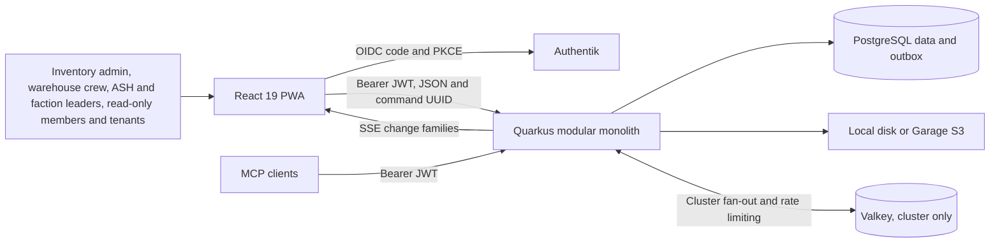

# ASH Inventory — Architecture Overview

This page is the entry point to the architecture documentation. Current source behavior, architectural targets and runtime acceptance are kept distinct throughout.

## Document map

| Document | Owns | Read it for |
|---|---|---|
| [Product Requirements Document](PRODUCT_REQUIREMENTS.md) | Features, functions, business rules, requirement IDs and glossary | What users need and what the product currently supports |
| [Technical Requirements](TECHNICAL_REQUIREMENTS.md) | Frameworks, dependencies, boundaries, security, runtime constraints and observability | What the app is built with and how components cooperate |
| [App Flow](APP_FLOW.md) | Routes, navigation, user journeys and lifecycle states | How users reach and complete tasks |
| [Design Brief](DESIGN_BRIEF.md) | Theme tokens, typography, layout, component patterns and accessibility goals | How screens should look and behave |
| [Database Schema and Data Storage](DATABASE_SCHEMA.md) | All 59 tables, relationships, stock authority, media, caches, personal data and recovery | Where data lives and which store is authoritative |
| [Implementation Plan and Progress](IMPLEMENTATION_PLAN.md) | Prioritized gaps, target refactors, progress and acceptance evidence | What is complete, partial, planned or still unverified |

Each subject has one owner above. Keep detailed requirements in the PRD, stack decisions in Technical Requirements and unfinished work in the progress register rather than duplicating their full tables here.

## System context

A modular monolith keeps stock, order, custody and lifecycle changes in local ACID transactions. Default deployment is a single API node. The cluster template adds API replicas and Valkey while retaining shared PostgreSQL/media; it does not establish automatic database failover.

## Cross-cutting rules

- Server state authorizes stock operations; cached catalogs, report snapshots and queued commands never do.
- Stock-affecting commands validate current state under locks, deduplicate command IDs and commit movement/projection/audit/outbox changes together.
- Preparation reserves; pickup transfers custody. Physical transfer transit and unreceived supplier orders are separate. Pending return submission remains custody until acceptance.
- Private account ownership and explicit view/edit grants are separate from keeper, current custodian and display owner name. Warehouse and other staff do not implicitly see private resources except the inventory admin.
- REST, MCP and offline replay delegate to the same services/policies; DTOs separate persistence from API output.
- Data is disposable; change the single schema baseline/entities directly. No incremental migrations or compatibility adapters are the intended development model.

The source still contains exceptions and unfinished consolidation: guarded master-data deletion, an opening-amount stock fallback, two order models, duplicate maintenance state, legacy visibility and full catalog-page draining. These are explicitly tracked in [Implementation Plan and Progress](IMPLEMENTATION_PLAN.md), rather than described as completed target architecture.

## Operational guides

| Guide | Scope |
|---|---|
| [Offline Mode](OFFLINE_MODE.md) | Supported queue commands, cached reads, review and correction |
| [MCP Support](MCP_SUPPORT.md) | Tool/resource/prompt contracts and authenticated client connection |
| [Authentik setup](AUTHENTIK_SETUP.md) | Provider, group naming, token lifetimes and audience mapping |
| [Deployment Step 1](DEPLOYMENT_STEP1.md) | Single application node with separate storage/recovery plan |
| [Deployment Step 2](DEPLOYMENT_STEP2.md) | Proposed replicated API/multi-host topology and its limits |
| [PostgreSQL logical replication](postgres-logical-replication.md) | Operator publication/subscription procedure |
| [Test inventory](../tests/README.md) | Existing regression ownership and historical test procedures |
| [Agent guidelines](../agent.md) | Repository rules for builds/tests, contracts and schema edits |

## Verification status

Feature presence in source is tracked separately from runtime acceptance. Authentik, device/camera/offline, rendered accessibility/export, real S3/restore, load and cluster acceptance are open; see ACC-01..05 in [Implementation Plan and Progress](IMPLEMENTATION_PLAN.md).
