# Database Schema and Data Storage

This document owns backend persistence, relationships, stock authority and browser/media storage. The exact executable schema is [V1.0.0__init.sql](../backend/src/main/resources/db/migration/V1.0.0__init.sql) (including pickup groups, assigned roles, owned share groups, grant inheritance and public availability); JPA mappings follow their [module owner](../backend/architecture/modules.json); operational entities are in [model/](../backend/src/main/java/org/ash/inventory/operations/internal/model). Planned model changes are in [Implementation Plan](IMPLEMENTATION_PLAN.md).

## 1. Persistence boundaries

| Store | Contents | Authority / lifetime |
|---|---|---|
| PostgreSQL | Catalog, positions, assets, orders, ledger, custody, policy, lifecycle, purchasing, reports, audit and outbox | Authoritative business state |
| Local disk or Garage S3 | Images, certificates, acknowledgements and supplier documents | Resource-bound files; database retains references |
| Valkey (cluster only) | Event fan-out and distributed rate limiting | Infrastructure coordination, not authoritative inventory |
| Per-node Caffeine | Faction reference data keyed by database revision | Expiring reference cache |
| Session TanStack Query cache | API results and private projections | Active account's in-memory view |
| IndexedDB `ash-inventory` | Organizational catalog cache, offline commands, failures and history | Device/account-scoped snapshots; never stock authority |
| IndexedDB `ash-auth` | Persisted OIDC session for cold starts | Cleared at logout; valid online tokens still required |
| Browser Cache API | PWA shell and same-origin assets | Build-versioned app files; excludes API and third parties |
| localStorage | Theme mode and selected event preference | UI preferences, not inventory |

## 2. Schema conventions

The baseline declares **64 tables**. Most domain entities have UUID IDs and creation/update timestamps. Exceptions include bigint identity order history, composite join tables, report rows keyed by report name, and revision counters keyed by `(name, shard)`. SQL enum-like fields use string/check constraints; JSON is PostgreSQL `jsonb`. Calendar dates use `date`, instants use timestamp with time zone, event logistics wall-clock times use timestamp without time zone, money generally uses integer cents and meters use decimal numeric values.

Flyway applies the single editable baseline in dev/test/prod; Hibernate validates it. Data is disposable: recreate the database after a baseline change. There are no upgrade migrations or backfills. The test profile cleans its configured PostgreSQL test database at startup.

Some columns and foreign keys are added later inside the same baseline, so the complete SQL file, not just the opening CREATE TABLE blocks, defines the schema. A non-null UUID inside JSON or a polymorphic target does not automatically have a foreign key.

## 3. Domain relationships

The diagram shows primary relational links, not every optional FK or JSON reference. Arrows do not imply cascading deletion.

```mermaid
erDiagram
    APP_USERS ||--o{ INVENTORY_ACCESS_POLICIES : owns
    INVENTORY_ACCESS_POLICIES ||--o{ INVENTORY_ACCESS_GRANTS : grants
    INVENTORY_ACCESS_POLICIES o|--o| ITEMS : protects
    INVENTORY_ACCESS_POLICIES o|--o| STORAGE_LOCATIONS : protects
    INVENTORY_ACCESS_POLICIES o|--o| ASSEMBLIES : protects
    STORAGE_LOCATIONS o|--o{ STORAGE_LOCATIONS : parent
    ITEMS ||--o{ ASSET_INSTANCES : serializes
    ITEMS ||--o{ INVENTORY_LOTS : groups
    ITEMS ||--o{ INVENTORY_POSITIONS : projects
    STORAGE_LOCATIONS ||--o{ INVENTORY_POSITIONS : stores
    INVENTORY_LOTS o|--o{ INVENTORY_POSITIONS : identifies
    ITEMS ||--o{ STOCK_TRANSACTIONS : records
    ASSEMBLIES ||--o{ ASSEMBLY_ITEMS : contains
    ITEMS ||--o{ ASSEMBLY_ITEMS : component
    EVENT_OCCURRENCES o|--o{ ORDERS : scopes
    FACTIONS o|--o{ ORDERS : requests
    ORDERS ||--o{ ORDER_LINES : contains
    ITEMS ||--o{ ORDER_LINES : requested
    ORDER_LINES ||--o{ STOCK_RESERVATIONS : reserves
    ORDERS ||--o{ CUSTODY_HANDOVERS : hands_over
    CUSTODY_HANDOVERS ||--o{ CUSTODY_HANDOVER_LINES : contains
    ORDER_LINES ||--o{ RETURN_RECONCILIATIONS : reconciles
    ITEMS ||--o{ RETURN_SUBMISSIONS : pending_check
    ITEMS o|--o{ DAMAGE_REPORTS : incident
    DAMAGE_REPORTS ||--o| REPAIR_CASES : repair
    ITEMS ||--o{ MAINTENANCE_SCHEDULES : schedules
    MAINTENANCE_SCHEDULES o|--o{ MAINTENANCE_RECORDS : evidence
    VENDORS o|--o{ PURCHASE_ORDERS : supplies
    PURCHASE_ORDERS ||--o{ PURCHASE_ORDER_LINES : contains
    PURCHASE_ORDERS ||--o{ GOODS_RECEIPTS : receives
    GOODS_RECEIPTS ||--o{ GOODS_RECEIPT_LINES : contains
    ITEMS ||--o{ EQUIPMENT_COMMITMENTS : commits
    EQUIPMENT_COMMITMENTS ||--o| LOAN_ARRANGEMENTS : agreement
```



Faction and general orders share `orders` (`kind=faction/general`), relational `order_lines`, asset assignments, history, reservations, handovers and reconciliations. Faction orders require an event, faction and unique code; general orders have a name/purpose and an optional draft event. Damage can target an item **or** an assembly (XOR), so the item relationship shown above is optional for assembly incidents.

## 4. Table inventory

### Identity and access (8 tables)

| Table | Key data and relationships |
|---|---|
| `app_users` | UUID; unique `(issuer, external_subject)`; name/email from OIDC; role (`tenant`, `read_only`, `faction_leader`, `ash`, `warehouse_crew`, `admin`), JSON assigned `roles`, JSON faction memberships and `access_revision`, managed in the app; optional user-chosen `ntfy_topic` and HTTPS `webhook_url`  active/deactivation/reason fields; revision-checked lifecycle |
| `revoked_sessions` | Access-token SHA-256 hash PK; user FK and expiry; expired hashes are purged hourly |
| `inventory_access_policies` | UUID; owner user FK; revision, `public_use` (binary public availability for privately owned items) and timestamps |
| `inventory_access_groups` | UUID; optional owner user FK (null = admin group, usable by everyone); name unique per owner, case-insensitive; revision |
| `inventory_access_group_members` | Composite `(group_id, user_id)` PK; group/user FKs |
| `inventory_access_grants` | Policy plus user **or** group; `can_edit`; XOR grantee check; unique grant per policy/grantee |
| `inventory_access_links` | Materialized grant inheritance: policy FK and ancestor policy FK (cascade), unique pair, ancestor index. A private item links to the policies of its private home location and that location's private ancestors; a private location to its private ancestors |
| `inventory_media_objects` | Unique object key; uploader FK; optional resource type/ID pair; both absent means staged |

Items, locations and assemblies each have a unique nullable `access_policy_id`. A policy establishes private access and account ownership; it is the only item visibility rule (the former `visibility_scope` and assigned user/group columns were removed). Display `owner_name`, keeper, location keeper and current custodian are different roles. Grants flow down private location trees through `inventory_access_links` (shares and owner of a building apply to what is stored in it); they do not disclose private components, nor an item's private location (a location needs its own share).

### Catalog and storage geography (5 tables)

| Table | Key data and relationships |
|---|---|
| `items` | UUID, unique SKU, category/subcategory, description/hint, event tags, active flag, tracking mode, inventory role, minimum stock, value cents, ownership/provider metadata; creator-defaulted `responsible_person_id` or free-text `responsible_person_name` (varchar 255); storage/return locations; category meters/dates |
| `item_images` | UUID; item FK, object key and display order |
| `assemblies` | UUID; name, category/subcategory, description/hint, image object key, event tags, active flag and optional access policy |
| `assembly_items` | Composite `(assembly_id, item_id)` PK; component quantity |
| `storage_locations` | UUID; parent location and keeper user FKs; the depth is the role (0 = location without stock, 1 = section, 2+ = storage place, see [Storage locations](STORAGE_LOCATIONS.md)), level `code` (unique among the siblings visible to the editor, checked under the hierarchy lock; hidden private siblings of other accounts don't count) and maintained `full_code` (`BH-CE-R2-F7`), description, coordinates, zoom, overlay URL/bounds, active flag and optional access policy |

Location services enforce no cycles and keep stock out of top-level locations; choosing a parent requires view access to it, and edit access when the parent is private. Item tracking mode becomes immutable after stock or movements; serialized items cannot be consumable. Code resolves identities without changing stock. Category data includes vehicle fuel consumption/battery due date, generator operating hours and food best-before.

**Retirement:** items, locations and assemblies have an `active` flag and are retired, never deleted, so order lines, damage reports and codes keep their targets. Event occurrences are deleted only while no orders, movements, return submissions or commitments reference them (`CatalogOrm.hasEventHistory`); their planning overrides are deleted with them, and their attendance (with roles) and timeline rows cascade on deletion; `event_people` rows are kept for other events.

### Stock and warehouse operations (9 tables)

| Table | Key data and relationships |
|---|---|
| `asset_instances` | UUID; item/current location/current custodian FKs; unique asset code; availability/condition/service state, hours, serial/manufacturer, active flag and version |
| `inventory_lots` | UUID; item FK; unique `(item_id, lot_number)`; expiry/best-before/manufacture, supplier lot, requirements and status |
| `inventory_positions` | UUID; item/location/optional lot FKs (lot composite with item); on-hand, damaged, quarantined and transit quantities; last count; version. One row per item/location/lot (`unique nulls not distinct`). Reservations are not stored here: they are computed from live order reservations |
| `stock_transactions` | UUID; item/actor FKs plus optional asset/lot/order/event/damage/locations; movement type, quantity, UTC time, reason/notes, before/after availability, idempotency UUID, position map and related-entity reference |
| `stock_reservations` | UUID; item/asset/order/line/location/creator links; requested/reserved/released quantities and status; version; unique active asset reservation key |
| `inventory_transfers` | UUID; source/destination locations, requester/receiver, unique transfer number and idempotency key, status, dispatch/receipt times |
| `inventory_transfer_lines` | UUID; transfer/item/optional asset/lot FKs; requested/picked/received/discrepancy quantities |
| `inventory_count_sessions` | UUID; unique session number; location subtree/item/category scope, blind flag, creator/approver, status/times |
| `inventory_count_lines` | UUID; session/item/location/lot/asset links; observed/recounted/approved/variance quantities and expected asset version/state |

The position constraint uses `UNIQUE NULLS NOT DISTINCT (item_id, location_id, lot_id)`: one null-lot row is enforced by PostgreSQL as well as transaction locking.

### Events, orders and custody (13 tables)

| Table | Key data and relationships |
|---|---|
| `event_occurrences` | UUID; event type/name/status, start/end dates, editable daily regular/breakfast and first-day regular stamp rates, planned/used JSON quantities  optional UTC order deadline |
| `event_people` | UUID; shared people registry: name and optional unique `app_users` link (`on delete set null`); event crew usually has no account. A rename applies at every event |
| `event_attendees` | UUID; event FK with deletion cascade and person FK, unique per `(event, person)`; optional local arrival/departure times, food-stamp-issued flag and notes; API calculates entitlement by attendance and catering days using editable rates on `event_occurrences` (daily main/breakfast and first-day main) and crew `catering` timeline periods |
| `event_attendee_roles` | Element collection of an attendance (cascade): `faction_leader`/`faction_deputy`/`faction_hq_crew` with a required faction FK of the event type, `as_held`, or `event_crew` with optional assigned work; unique `(attendee, role, faction)` with nulls not distinct |
| `event_timeline_entries` | UUID; event FK with deletion cascade; in-game/preparation/catering category, title, local start/optional end, owner/team, location/area, planned/in-progress/completed status and description |
| `factions` | UUID; unique `(event_type, slug)`, name and active flag |
| `orders` | UUID; faction/general kind; creator and optional event/faction FKs; kind-specific metadata constraint, unique faction code, general name/purpose; status, pickup and lifecycle actors |
| `order_lines` | UUID; order/item/source assembly/source location FKs; line order, requested, allocated, reserved, prepared, handed-over and reconciliation quantities |
| `order_line_asset_assignments` | UUID; order/line/asset FKs; unique `(order_id, asset_instance_id)`; reconciled flag |
| `order_history` | Bigint identity; order/actor links, occurrence time, action/from/to, notes, JSON delta and unique idempotency key |
| `custody_handovers` | UUID; order, marshal, collector and location FKs; unique handover code/idempotency key, type/time, acknowledgement key and condition confirmation |
| `handover_evidence` | UUID; handover/recording-user FKs; explicit condition attestation/notes, authenticated attachment key, unique command and input hash |
| `custody_handover_lines` | UUID; handover/order line/item/optional asset FKs; quantity and condition notes |

Both order kinds use `OrderService` and the same relational foreign keys and stock lifecycle (PLAN-02). The baseline replaces the former tables directly; disposable databases must be recreated.

### Returns, lifecycle and maintenance (7 tables)

| Table | Key data and relationships |
|---|---|
| `return_reconciliations` | UUID; faction order/line/item/asset/recorder links; outcome, quantity, condition before/after, note and idempotency key |
| `return_submissions` | UUID; item/asset, submitter/return-for user, expected location, order/event links; status, placement photo, prior asset state/version and acknowledgement actor/time; unique member command ID |
| `damage_reports` | UUID; item XOR assembly; optional asset/order/handover, reporter/handler; severity/status, quantities, notes, safety impact, position map and idempotency key |
| `repair_cases` | UUID; unique damage-report FK; asset/handover/repair owner/vendor/approver links; status, parts/cost/verification notes and pending repaired quantity |
| `maintenance_schedules` | UUID; item/asset/responsible user; date/hour/usage interval, warning, next due, checklist, active/checkout-block flags and optional category-template origin |
| `runtime_entries` | UUID; item, optional asset/event/order, recording user; hours booked, meter reading after, source (`manual`, `return_check` for order reconciliation and accepted return submissions, `maintenance`, `correction`), time and notes. Every meter change is booked here |
| `maintenance_records` | UUID; item/asset/schedule/inspector links; inspection type/result/time, hours, next due, certificate key/number and notes |

Item-level maintenance status/calendar columns still duplicate schedule-based state. They are used in current evaluation/report fallback paths; schedules-only maintenance is a target (PLAN-10).

### Planning and purchasing (7 tables)

| Table | Key data and relationships |
|---|---|
| `planning_overrides` | UUID; event/item/actor FKs; quantity/reason and timestamps |
| `vendors` | UUID; name/contact/address/payment/internal notes; active/preferred flags |
| `purchase_orders` | UUID; vendor/event/creator links; unique order number, status, order/expected dates |
| `purchase_order_lines` | UUID; purchase/item FKs; unique purchase/item pair, ordered/received quantities, unit price cents |
| `goods_receipts` | UUID; purchase/receiver/location links; unique receipt number/idempotency key, status and received time |
| `goods_receipt_lines` | UUID; receipt/purchase line/item/lot FKs; expected/received/damaged/rejected quantities |
| `vendor_documents` | UUID; vendor/purchase/receipt/uploader links; unique storage key, type/MIME/size/checksum, original filename, reference/date/value/currency/retention |

Receiving is a stock command. An unreceived purchase line is ordered supply, not physical on-hand, custody or transfer transit. Supplier-document access is role-restricted and still subject to resource policy.

### Ownership and lending (2 tables)

| Table | Key data and relationships |
|---|---|
| `equipment_commitments` | UUID; item/event/recording user links; quantity, JSON asset IDs, available window, pickup/return details, consent/cancellation evidence |
| `loan_arrangements` | UUID; unique commitment FK and provider location; loan/rental kind, provider/contact/terms, collection/return quantities/assets, transfer IDs, JSON history and revision |

Rental/loan economics and evidence live in the agreement's current fields/JSON; there is no separate billing/payment subsystem or relational loan-line table.

### Member work and system support (13 tables)

| Table | Key data and relationships |
|---|---|
| `member_requests` | UUID; requester/item/asset/location/handler links; kind/quantity/notes, status/response/time, unique command ID and revision |
| `notifications` | UUID; scalar recipient/order IDs across module boundaries; type/payload, delivery/read state and retry evidence; optional `dedupe_key` (unique per recipient/type) so an `item_requested` notice is sent once per order or request  next attempt, lease UUID/expiry and bounded retry delivery state; `delivered_channels` that already acknowledged |
| `action_reminders` | UUID; user FK, action key and reminder time; unique user/action |
| `category_maintenance_policies` | UUID; unique category, interval days and timestamps |
| `operational_reports` | Report name PK; generation version/times, source token and JSON rows; eight snapshot kinds |
| `sync_command_audit` | UUID; unique command ID, owner/operation/payload/local time, server result/status/conflict/retry; supersedes and resolution-root FKs to command IDs |
| `domain_event_outbox` | UUID; unique event ID, aggregate/actor (and impersonating administrator)/command, type/payload, aggregate revision, delivery status/attempts/availability/published time/error |
| `report_rebuild_jobs` | Reporting-owned coalesced jobs; requester, state, attempts, lease token/expiry and safe failure text |
| `media_cleanup_jobs` | Operations-owned object cleanup intents; key, due time and fenced deletion lease |
| `integration_aggregate_sequences` | Integration-owned commit-ordered revision per aggregate type/UUID |
| `integration_subscriptions` | Integration-owned consumer name, event prefixes, replay start and enabled state |
| `integration_deliveries` | Consumer/event composite key; lease, attempts, acknowledgement and per-consumer dead-letter state |
| `source_revisions` | Composite `(name, shard)` PK; revision/epoch; 16 shards per tracked source table |

All 64 baseline tables are listed once above. The complete module owner register is [modules.json](../backend/architecture/modules.json); notification and reporting code do not navigate operational JPA entities. Media registry rows also carry purge lease/token expiry. This inventory is descriptive; use the SQL for exact lengths, defaults, nullability and constraint definitions.

## 5. Stock authority and invariants

```text
onHand     = posted inbound movement - posted outbound movement
checkedOut = checkout - checkin - consumed - missing
inTransit  = dispatched transfers not yet received
owned      = onHand + checkedOut + inTransit
available  = max(0, onHand - damaged - reserved - blocked/quarantined)
ordered    = unreceived purchase quantity, displayed separately
```

These are conceptual aggregates, not SQL to apply indiscriminately to each tracking mode. Bulk uses ledger totals and lockable positions; serialized stock is classified from exact asset states. Eligibility then blocks unavailable stock according to maintenance, contributor damage, usable lots and equipment consent. A pending return is still checked out. Repairs never create units; write-off is authorized separately.

The ledger is the only origin of bulk quantities: an item's opening amount is posted as an `added` movement on creation, and items store no quantity column. Later changes use stock commands.

Order reconciliation must satisfy `handedOver = returned + consumed + damaged + writtenOff + outstanding`, with missing accounted within outstanding. A custody write-off is a `written_off` movement with `custody_write_off = true`; stock totals treat it like consumption of checked-out units. Reservations can only use eligible availability; an order edit credits its own allocation, not other orders' stock. Position/asset changes, movement evidence and outbox writes commit together under locks.

Committed stock, order, handover, reconciliation, runtime, maintenance and sync history is database-enforced append-only. Triggers permit finalization only in the inserting transaction (including `availability_after` and attachment binding), then reject UPDATE/DELETE. Online reversal inserts a signed compensating row linked by unique `reverses_id`; it never rewrites the original. Outbox delivery records remain mutable and retain their separate retention policy.

## 6. Query, indexing and snapshot behavior

FK/location/stock indexes support operational reads. Catalog substring search uses `pg_trgm` GIN indexes on lowercased name/SKU/category. Lowercased code indexes accelerate exact case-insensitive lookup; those indexes are non-unique, while stored SKU/asset values have unique constraints.

API list mapping batches ledger, damage, reservation, position, asset, maintenance and purchasing facts. Dynamic availability is not globally cached. Faction reference caching uses committed revisions. Privacy query scoping and `PrivacyResponseFilter`/reference-graph projection currently coexist (PLAN-01).

Statement triggers increment the relevant `source_revisions` shard (`pg_backend_pid() % 16`) within the source transaction, including rollback behavior. Readers sum shards; report source tokens and faction cache keys detect committed changes. `operational_reports` stores snapshots rebuilt explicitly or on stale/missing reads, not continuous materialized live inventory. Kinds: events, availability, returns, repairs, maintenance, purchases, counts, movements.

## 7. Files, offline storage and retention

Media uploads first create staged metadata; attachment binds object keys to a resource. Allowed bytes/types/quotas and 24-hour staged expiry are configured in the API. Private media is authorized per download and uses no-store; image/certificate/document references do not grant access themselves. Store opaque object keys rather than granting public bucket access. Coordinate database and object-storage recovery.

`ash-inventory` currently uses IndexedDB version 4:

| Object store | Key | Content |
|---|---|---|
| `catalog-cache` | Namespaced `key` | Query/detail snapshot plus successful-download timestamp |
| `sync-queue` | `idempotencyKey` | Owner, operation/payload, client time and correction link |
| `sync-failures` | `idempotencyKey` | Rejection/conflict evidence |
| `sync-history` | `idempotencyKey` | Applied/archived local evidence |

Catalog keys include account/role/faction context and normalized query. Private projections are excluded from durable catalog caching. Queue/failures/history belong to the original account and cannot replay under another. Authentication is separately mirrored to `ash-auth` version 1, store `session`, key `oidc-session`, including token/session data. Session storage and memory support normal requests; logout clears session data and account caches. Device/browser eviction can remove offline state; it is not a backup.

The PWA shell cache is versioned per build. Published outbox events default to 30-day purge. Staged media defaults to 24 hours. Permanent stock/order/access evidence and downloaded exports have different lifetimes; exported files cannot be recalled by revoking an app grant.

## 8. Personal data

Where the app stores personal data (GDPR/DSGVO Art. 30 input) and what is still missing for data-subject requests. Table details are in §4. This is a technical inventory, not legal advice; purposes and legal bases need the association's decision.

### Where personal data lives

| Data | Stored in | Source | Retention today |
|---|---|---|---|
| Name, email, stable subject (`issuer`, `sub`), role, faction memberships | `app_users` | Name/email/subject from Authentik claims, refreshed at sign-in; role and factions set by the inventory admin | Retained identity blocking key/history; explicit deactivation and guarded display-data pseudonymization |
| Actor references on every movement and transition | `stock_transactions`, `order_history`, `return_reconciliations`, `custody_handovers`, damage/repair/maintenance records, `inventory_count_*`, `goods_receipts` | App actions | Permanent (append-only evidence) |
| Collector name, pickup coordinates, notes | `orders`, `custody_handovers` | Staff input | Permanent |
| Handover acknowledgements, placement photos, certificates | Media store (local disk or Garage S3) referenced from `custody_handovers`, `return_submissions`, `maintenance_records` | Uploads | Permanent once attached; staged uploads purged after 24 h |
| Display owner, keeper name/contact | `items` | Staff/owner input | Until edited; items are retired, not deleted |
| Private location codes, descriptions and coordinates, keeper user | `storage_locations` | Owner input | Until edited; retired, not deleted |
| Loan contact and terms, pickup/return details, consent evidence | `loan_arrangements`, `equipment_commitments` | Owner/staff input | Permanent |
| Requests, reminders, notifications | `member_requests`, `action_reminders`, `notifications` | Member actions | Requests indefinite; terminal notices and inactive reminders default 180 days, configurable |
| Event attendee names, optional account link, roles, arrival/departure times, notes | `event_people`, `event_attendees`, `event_attendee_roles` | Planner input; event crew often has no app account | Unused people deletable; linked accounts follow pseudonymization, unlinked people with only events older than 730 days are pseudonymized by default; attendance evidence retained |
| Access grants and group membership | `inventory_access_grants`, `inventory_access_group_members` | Owner/admin | Until revoked |
| Offline command payloads | `sync_command_audit` | Device replay | Indefinite |
| Actor and payload of domain events | `domain_event_outbox` | Every command | Purged 30 days after publication |
| Uploader of media and vendor documents | `inventory_media_objects`, `vendor_documents` | Uploads | Permanent once attached |
| Tokens incl. ID token (name, email), cached catalog, queued commands | Browser IndexedDB `ash-auth`, `ash-inventory` | Device | Until logout (auth) or browser eviction (cache/queue) |
| Request traces | OpenObserve, if enabled ([Observability](TECHNICAL_REQUIREMENTS.md#7-observability)) | API | OpenObserve retention setting |
| Logical replica and backups | Storage VPS | Replication/backup jobs | Mirrors primary; backup retention per operator |

Vendor contact data in `vendors` concerns businesses, but may name individual contact persons.

### Access

Personal data of other members is visible according to role and resource policy ([Technical Requirements §5](TECHNICAL_REQUIREMENTS.md)). Exported CSV/PDF reports leave the app's control and cannot be recalled.

### Data-subject workflows and remaining manual review

| ID | Gap | Notes |
|---|---|---|
| PD-01 | Implemented offboarding | Active flag, obligation overview and private/group owner transfer; IdP directory synchronization is separate |
| PD-02 | Guarded pseudonymization | Clears account/attendee display data and transient access data after obligations are resolved; retained history/free text/media/backups require operator review |
| PD-03 | Person-scoped ZIP export | Admin-only relational export, indirect attendance and media manifest, with explicit size limits |
| PD-04 | Configurable transient retention | Daily bounded notice/reminder/unlinked-attendee expiry; business-history retention remains an explicit indefinite policy |
| PD-05 | Event registry deletion/pseudonymization | Unused registry people can be deleted in the existing directory; linked accounts use the person workflow and old unlinked attendees use configured retention |

They are tracked as FEAT-02/03 in [Implementation Plan and Progress](IMPLEMENTATION_PLAN.md) and need a decision on retention periods before implementation.

## 9. Deployment and recovery

Default Compose uses PostgreSQL 18; cluster replicas share the primary database. The storage Compose hosts a separate PostgreSQL instance for logical replication. Publication/subscription, schema copying and backup jobs require operator setup; the replica service alone does not establish replication.

Logical replication is an asynchronous table copy, not physical hot standby or automatic database failover. Matching DDL and sequence management are operator responsibilities. WAL archiving, dump encryption, media synchronization and claimed RPO/RTO values need an exercised recovery plan. See [logical replication](postgres-logical-replication.md), [Step 1](DEPLOYMENT_STEP1.md) and [Step 2](DEPLOYMENT_STEP2.md). Restore, real S3 and cluster acceptance remain open (ACC-04/05).

Maintenance dates/intervals are stored only in `maintenance_schedules`; item/asset due/status fields in responses are derived. `items.sku` is also unique case-insensitively. See [workflow contracts](WORKFLOW_CONTRACTS.md) and [operations](OPERATIONS_RUNBOOK.md) for privacy, evidence and retention boundaries.

Reversal rows retain `user_id` as the custody beneficiary and store the executing administrator in `reversed_by_id`; both are immutable after commit.
