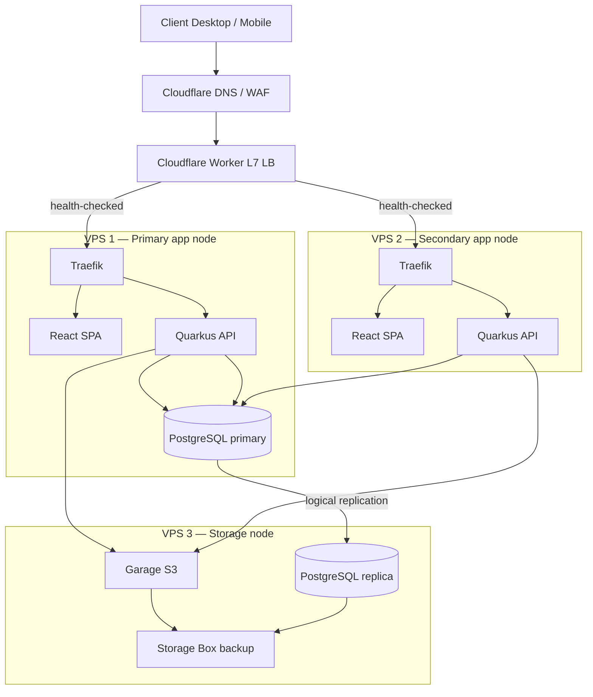

# Step 2 — Multi-node deployment topology

This proposed topology builds on **Step 1** with a second application node,
health-checked routing and API redundancy. Both API nodes still depend on the
shared primary database: losing that database can take the system offline.
The checked-in Compose network is not a verified multi-host or automatic
database failover deployment. See [Technical Requirements](TECHNICAL_REQUIREMENTS.md)
and [acceptance progress](IMPLEMENTATION_PLAN.md).



## Node layout

| Node | Hardware | Services | Role |
| --- | --- | --- | --- |
| VPS 1 | 4 vCPU, 8–16 GB | Traefik, React SPA, Quarkus API, PostgreSQL primary, Valkey, OpenObserve (optional, see [Observability](TECHNICAL_REQUIREMENTS.md#7-observability)) | Primary node; owns all writes |
| VPS 2 | 4 vCPU, 8–16 GB | Traefik, React SPA, Quarkus API | Second API node; reads and writes through the VPS 1 database and Valkey |
| VPS 3 | 2 vCPU, 4 GB | Garage S3, PostgreSQL replica, backup target | Storage & DR |
| Edge | Cloudflare | DNS, WAF, Worker load balancer | Routing |

VPS 2 has no database of its own. If VPS 1 or its PostgreSQL fails, VPS 2 cannot
serve requests either; the second node protects against API process/host
failures on VPS 2 and adds API capacity, not database availability.

## Running the cluster

`docker-compose.cluster.yml` defines two API replicas (`inventory-api-1`,
`inventory-api-2`), a shared `postgres` and `valkey`, `garage`, and one static
`inventory-app`. Both API nodes point at the same primary database and the same
Valkey instance, so **rate limiting and live-event fan-out are consistent across
nodes** (`API_RATE_LIMIT_BACKEND=redis`, `EVENT_BACKEND=redis`).

```bash
# On VPS 1 (primary)
docker compose -f docker-compose.cluster.yml up -d postgres valkey garage inventory-api-1 inventory-app
```

On VPS 2, point the API at VPS 1 over the private network and start it **without
dependencies**; otherwise Compose also starts an empty local `postgres`, `valkey`
and `garage`, and the node silently uses them. In VPS 2's `.env`:

```dotenv
DB_URL=jdbc:postgresql://10.0.0.10:5432/inventory
REDIS_URL=redis://10.0.0.10:6379
S3_ENDPOINT=https://s3.example.com
```

```bash
# On VPS 2 (secondary)
docker compose -f docker-compose.cluster.yml up -d --no-deps inventory-api-2 inventory-app
```

On VPS 1, publish PostgreSQL and Valkey only on the private address
(`DB_REPLICATION_BIND_ADDRESS=10.0.0.10`, `VALKEY_BIND_ADDRESS=10.0.0.10`) and
firewall them to VPS 2/VPS 3. Valkey has no password in the checked-in
configuration, so never bind it to a public interface.

Keep the storage node from Step 1 (`docker-compose.storage.yml`) running on VPS 3
for Garage S3 and the logical replica.

## Health-checked routing (Cloudflare Worker)

The Worker checks `/q/health/ready` (which includes the database connection) and
sends traffic to the first healthy node:

```text
VPS1 ready → VPS1
VPS1 not ready → VPS2
```

A minimal Worker. `PRIMARY_ORIGIN` and `SECONDARY_ORIGIN` are Worker environment
variables holding each node's direct origin, e.g. `https://node1.example.com`:

```js
const HEALTH_TTL_MS = 10_000;
let cached = { origin: null, checkedAt: 0 };

async function pickOrigin(env) {
  if (cached.origin && Date.now() - cached.checkedAt < HEALTH_TTL_MS) return cached.origin;
  for (const origin of [env.PRIMARY_ORIGIN, env.SECONDARY_ORIGIN]) {
    try {
      const health = await fetch(`${origin}/q/health/ready`, { signal: AbortSignal.timeout(2000) });
      if (health.ok) {
        cached = { origin, checkedAt: Date.now() };
        return origin;
      }
    } catch { /* try next origin */ }
  }
  cached = { origin: null, checkedAt: 0 };
  return null;
}

export default {
  async fetch(request, env) {
    const origin = await pickOrigin(env);
    if (!origin) return new Response('Service unavailable', { status: 503 });
    const url = new URL(request.url);
    return fetch(new Request(`${origin}${url.pathname}${url.search}`, request));
  },
};
```

The health result is cached per Worker isolate for 10 seconds, so a node failure
is noticed after at most that interval plus the 2-second timeout; this is not a
measured failover time. A request already sent to a failing node is **not**
retried on the other node, because request bodies cannot be replayed safely. The
PWA's offline queue and command UUIDs cover retries of supported commands.
Cloudflare's paid Load Balancing product provides the same health-checked
routing without custom code.

## Backup & disaster recovery

### Schema initialization

Current databases are disposable. An empty production database runs the single
`V1.0.0__init.sql` baseline and Hibernate validates it. Recreate disposable
databases after baseline changes; the old pre-Flyway baselining and incremental
upgrade procedure is removed. No database reset is performed by this guide.

1. **Logical replication** — PostgreSQL primary on VPS 1 publishes table changes to the replica
   on VPS 3 (`wal_level=logical` is already set in the compose files).
2. **WAL archiving (proposed)** — configure `wal-g` / `pgbackrest` to push WAL to the Storage Box.
   RPO < 5 minutes is an unverified target, not a supplied backup job.
3. **Daily dumps** — encrypted `pg_dump` stored off-site.
4. **Garage S3 sync** — nightly sync of the media bucket to the Storage Box.

**Recovery target (unverified RTO < 30 min):** bring up a fresh node from the checked-in compose
files, initialize the canonical schema, restore the latest dump/WAL, update `PRIMARY_ORIGIN` /
`DB_URL` to the new node.

## Validation limits

This is a proposed topology, not a verified multi-host deployment. The checked-in
cluster compose describes services on one Docker network; separate hosts require
explicit reachable database, Valkey, media and proxy endpoints. Load capacity,
cross-host routing, fresh PostgreSQL initialization and restore procedures have
not been verified against the current source.
