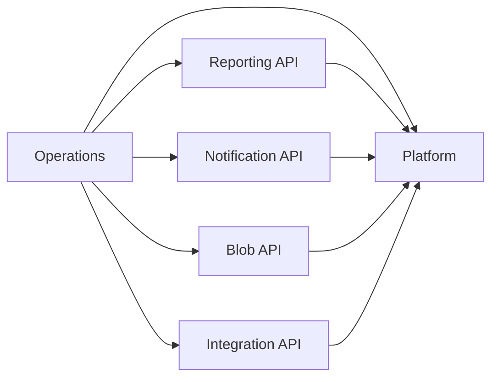

# Module boundaries and scaling

The backend has six enforced modules under `org.ash.inventory`. The module policy and complete table ownership register are in [modules.json](../backend/architecture/modules.json). [check-architecture.py](../scripts/check-architecture.py) runs in CI without building or executing the application.

| Module | Owns | Public boundary |
|---|---|---|
| `operations` | 60 tables: inventory, stock history, fulfillment, purchasing documents, event logistics, identity, privacy, media registry/cleanup, reminders and source revisions | REST/MCP/offline adapters live inside this module. Other modules receive owner facts or authorization decisions through ports they declare. |
| `notification` | `notifications` | Enqueue, recipient-scoped views/read state, personal-data export/erase, leased delivery; IDs and value records only |
| `reporting` | `operational_reports`, `report_rebuild_jobs` | Generations, queries/exports, job status; `ReportSource` and `ReportPolicy` ports |
| `blobs` | Opaque objects in local storage/S3; no database tables | Put/read/copy/delete and canonical keys; no resource authorization or transaction callbacks |
| `integration` | Outbox, aggregate sequences, subscriptions and consumer deliveries | Transactional publication, SSE refresh stream, durable per-consumer feed |
| `platform` | Technical primitives; no business tables | Errors/time/values, persistence primitives, telemetry, process roles and shared rate budgets |

The gate rejects undeclared dependencies, imports of another module's internals, project wildcard imports, known SQL/JPQL references to another owner's tables, foreign keys across module owners, entities exposed in API records, and module/injected-dependency cycles. This is a source gate, not a Java compiler or complete SQL parser. Reflection or a dynamically assembled table name must not be used to bypass ownership.

## Transactional core

Stock, reservations, order fulfillment, custody and privacy remain in one operations module. Their current immediate invariants and local rollback semantics remain intact. Purchasing sends an ID/value `ReceiptStock` command to `InventoryReceiptService`; it no longer books assets, positions, damage and ledger records itself. Physical stock reads and checkout eligibility are separate from command orchestration. Equipment and media authorization no longer call back into catalog/stock command services.

Notification recipient/order references are scalar IDs without cross-owner foreign keys. When extracting the queue itself, replace local transactional enqueue with a producer outbox intent and durable consumer; do not make a network call while holding inventory locks. Separating delivery workers already needs no change to command transactions.

The finer inventory/orders/purchasing/events/identity split in the [review](MODULAR_MONOLITH_REVIEW.md) remains the roadmap for decomposing this core. These internal capabilities are **not independently deployable today**. Moving them out requires the reservation/issue/return protocol described there. No remote call was substituted for an inventory transaction.

## Worker roles

`INVENTORY_PROCESS_ROLE` accepts `all` (single-node default), `api`, or `worker`. Worker-only processes reject `/api` and `/mcp` traffic with 503 while retaining health/telemetry endpoints. `INVENTORY_WORKER_JOBS` selects `all` or a comma-separated set:

`outbox,notifications,reminders,digests,reports,media,retention,sessions,stock-history`

`stock-history` observes total and available stock every minute, including time-based maintenance and equipment availability changes. Inventory commands record changed snapshots in their own transaction. The history starts when recording begins; earlier availability is not reconstructed from movement quantities.

Each job can also be disabled with `inventory.workers.<job>.enabled=false`. API processes do not dispatch outbox wakeups or run business jobs. SSE subscriptions stay on API processes; worker publishers use Redis in the cluster template.

[The cluster template](../docker-compose.cluster.yml) separates two API replicas, general operational workers, notification delivery workers and report workers. No deployment is performed by this change. All use the same image/database; these are independently scalable worker pools, not separate microservice deployments. The provided pool sizes reserve 17 database connections with one replica of each worker pool and two APIs; additional replicas multiply their pool budgets. Preserve database/operator/replication headroom.

Report jobs, notification deliveries and staged-upload purges use database claims and lease tokens. Report replacement and claim completion commit together; an old worker cannot overwrite a newer lease. Retention/session deletion is idempotent. Per-process scheduler `SKIP` is never treated as a cluster lock.

## Asynchronous reports

- `POST /api/reports/{name}/rebuild` returns **202** plus job state. Repeated requests coalesce. `GET /api/reports/{name}/job` exposes progress/failure; an explicit rebuild retries a failed job.
- A stale read schedules work and returns the previous generation immediately. The frontend polls every two seconds during pending/running/retry and displays a generation failure without discarding the old snapshot.
- `OperationalReportSource` builds owner-side value snapshots in a repeatable-read transaction without an HTTP actor. A requesting account must still be active warehouse staff when the worker starts. Otherwise the request is dropped, not failed, and the next authorized stale read queues a new one. A stale read queues its rebuild only after its own read transaction ends, so it never holds two pooled connections. Rows a source materializes and the output each have a default 25,000-row budget. Whole-table sizes are not budgeted: append-only history such as `stock_transactions` only invalidates reports; a failed/oversized generation never replaces the previous one.
- Report storage reads only its own tables. Current resource visibility is checked by `ReportPolicy` in batches of at most 200 rows **before** counting, paging and monthly totals. Fetching a page does not hydrate the stored generation as an entity. Authorization can require scanning the bounded generation; this is not an indexed analytical store or a measured throughput claim.
- Each report tracks its declared source tables. A source transaction invalidates affected reports; the clock still expires generations after five minutes. Exports pin a generation and reject more than 25,000 matching visible rows.

Tune `REPORT_MAX_SOURCE_ROWS`, `REPORT_MAX_OUTPUT_ROWS` and the report worker's database pool together. Splitting a very large report into partitions is future work; increasing a budget alone does not establish adequate memory or latency.

## Durable consumer feed

All integration endpoints require inventory admin authorization because raw payloads can contain private facts. They are not exposed as tenant APIs or MCP tools.

| Endpoint under `/api/integration/consumers` | Contract |
|---|---|
| `PUT /{consumer}` | Register `{prefixes: ["stock.", "order."], since: <instant>}`. Use a new consumer name to change replay scope. |
| `POST /{consumer}/poll?limit=50` | Lease up to 100 events; returns the oldest retained timestamp and independent delivery attempts/tokens. |
| `POST /{consumer}/ack` | Acknowledge `{eventId, lease}` after committing consumer effects and a local event-ID inbox. Repeating the same acknowledgement is safe; a superseded lease returns 409. |
| `GET /{consumer}/status` | Delivery state counts |
| `GET /{consumer}/dead-letters?limit=50` | Up to 100 event IDs requiring intervention |
| `POST /{consumer}/dead-letters/{event}/retry` | Reset that consumer's dead letter |
| `DELETE /{consumer}` | Remove its registration/deliveries and release its retention claim |

Publication still writes one outbox row in the business transaction and supplies SSE refresh hints. Durable consumers poll committed outbox rows independently of SSE publication state. Events have a monotonically increasing revision per aggregate; claim order across workers is not guaranteed. Delta consumers must reconcile revision gaps; full-snapshot consumers can discard stale revisions.

An event's payload is a change notification, not an inventory reconstruction log. Bootstrap from an authoritative owner snapshot, replay retained changes and fetch current owner state; a 404 removes a deleted projection. Register before taking the bootstrap snapshot so changes during bootstrap remain replayable. Check `oldestRetained`: history already purged before registration cannot be recovered from this feed. Remote consumers own their durable inbox/effect transaction and acknowledge only afterwards. An external HTTP acknowledgement is not a distributed transaction.

Enabled consumers retain matching events until acknowledged, including consumer dead letters. Monitor backlog/storage and retry or remove abandoned registrations deliberately. Outbox publication retries and consumer retries are separate. No external consumer has been registered by this implementation.

## Media lifecycle

The operations owner authorizes attachments/downloads; blob storage never calls back into resource services. Cleanup intents commit **before** an upload/copy, and the resource transaction atomically retains the destination and schedules superseded/source deletion. Crashes and failed callbacks leave durable cleanup work. Cleanup does not remove a currently registered object.

Abandoned staged objects are claimed across replicas. Once claimed for purge, an upload cannot be attached, even if the purge lease expires; another worker retries deletion. Registry removal is fenced by the claim token. Explicit staged deletion holds the registry authorization lock and queues object removal in the same transaction.

## Acceptance still required

The source boundary gate, Java syntax inspection and changed frontend lint/localization checks are separate from runtime acceptance. Builds/test suites have not run under the repository's current instruction. Before deployment, authorize and run PostgreSQL/Hibernate/CDI checks plus worker crash/retry, concurrent privacy, S3 cleanup, report budget and cluster/load acceptance. Recreate disposable databases from the directly edited baseline; there are no upgrade migrations or compatibility paths.
