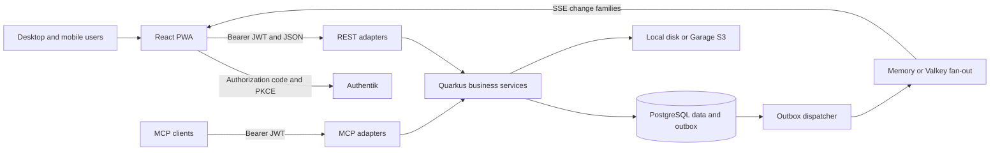

# Technical Requirements

This document owns the runtime stack, component boundaries and engineering constraints. Product behavior belongs in [Product Requirements](PRODUCT_REQUIREMENTS.md), persistence in [Database Schema and Data Storage](DATABASE_SCHEMA.md), and remaining work in [Implementation Plan and Progress](IMPLEMENTATION_PLAN.md). Versions below are declarations in this repository, not claims about the latest upstream releases.

## 1. System structure

ASH Inventory is a React PWA backed by a Quarkus modular monolith. REST, MCP and offline replay call the same business services. Inventory, allocation, custody, returns and lifecycle changes share PostgreSQL transactions; there is no separate inventory microservice or client-authoritative stock engine.



## 2. Frontend framework requirements

Source: [package.json](../package.json), [Vite configuration](../vite.config.ts), [App](../src/App.tsx).

| Concern | Current dependency or implementation | Requirement / target |
|---|---|---|
| Runtime | React / React DOM `^19.3.0`; React Compiler `^1.0.0` | Use the compiler; avoid redundant manual memoization |
| Tooling | Bun with `bun.lock`; Vite `^8.3.4`, React plugin `^6.1.2` | Bun manages frontend dependencies and scripts |
| Language | TypeScript `~6.0.3`; `typescript-native` aliases TypeScript `~7.0.2` | Intentional two-engine setup: TS 7 (native) performs build typechecking; `typescript-eslint` requires the JavaScript compiler API with a `typescript` peer `<6.1`, so TS 6 stays for lint until typescript-eslint supports TS 7 |
| UI | MUI Material/icons `^9.5.0`, DataGrid `^9.15.0`, Emotion `^11.14.x` | Reuse theme and shared controls; see [Design Brief](DESIGN_BRIEF.md) |
| Server state | TanStack React Query `^5.104.2` | Session-scoped QueryClient; selective query invalidation |
| UI state | Zustand `^5.0.15` | Keep UI preferences separate from server state |
| Routing | React Router DOM `^7.18.4`, BrowserRouter, lazy Routes | Data router / loaders remain planned, PLAN-08 |
| Localization | i18next `^26.4.4`, German and English | Key-only DE/EN translations, typed keys and catalog validation; PLAN-09 complete |
| Dates | MUI X Date Pickers `^9.15.0`, Day.js `^1.11.23` | Localized DD-MM-YYYY / 24-hour pickers through one `LocalizationProvider` |
| Maps | Leaflet `^1.9.4`, React Leaflet `^5.0.0` | Location hierarchy, geographic position and overlays |
| Charts | Recharts `^3.10.1` | Dashboard / reporting presentation |
| Labels and exports | qrcode `^1.5.4`, jsPDF `^4.2.1` | Generate labels and PDFs; import heavy exports on demand |
| Authentication | Custom `oidcClient.ts`, `authManager.ts`, durable session storage | `oidc-client-ts` / `react-oidc-context` are targets, PLAN-05 |
| API contracts | Handwritten types, `apiClient.ts`, capability-based `resourceFactory.ts` | OpenAPI-generated `openapi-typescript` / `openapi-fetch` are targets, PLAN-04 |
| Offline | Custom IndexedDB cache, queue, history and conflict handling | Query persistence and persisted paused mutations are targets, PLAN-06 |
| Forms | Component field state and shared dialogs | react-hook-form and zod are targets, PLAN-07 |
| Lint | ESLint `^10.12.0`, TypeScript ESLint `^8.71.2`, React hooks `^7.1.1` | Apply TypeScript and React Compiler lint rules |

Target libraries are **not installed requirements of the current app**. Their adoption must retain existing behavior and privacy guarantees.

Frontend ownership:

```text
pages/       route composition and screen orchestration
components/  shared controls, forms, dialogs, tables and workflow sections
hooks/       query and mutation bindings
services/    transport, contracts, authentication, offline persistence
types/       API/domain types
utils/       calculations, code resolution, formatting and access UX
store/       Zustand UI state
i18n/        language resources
```

Pages delegate transport to services. Stock displayed by the client comes from the API projection. UI access checks improve navigation; backend checks authorize commands. `usePagedList` loads the first server page and further pages only on demand; `useCompleteList` is reserved for bounded sets such as one item's positions, assets or lots (PLAN-03).

## 3. Backend framework requirements

Source: [Maven project](../backend/pom.xml), [runtime configuration](../backend/src/main/resources/application.properties).

| Concern | Current implementation |
|---|---|
| Language/build | Java 25, Maven, Quarkus platform `3.39.5` |
| DI / HTTP / JSON | Quarkus Arc, REST Jackson, Hibernate Validator |
| Persistence | Hibernate ORM and PostgreSQL JDBC; custom ORM collaborators, no Panache dependency |
| Schema initialization | Flyway with PostgreSQL support; single editable baseline; Hibernate `validate` |
| Authentication | Quarkus OIDC service mode; bearer JWTs; Authentik groups |
| API discovery | SmallRye OpenAPI; development Swagger UI |
| Operations | SmallRye Health, scheduler, optional OpenTelemetry export |
| Reference caching | Quarkus Cache / Caffeine, committed revision keys |
| Cluster support | Quarkus Redis client communicating with Valkey |
| Media | Quarkus Amazon S3, AWS SDK URL connection client, or local filesystem |
| AI integration | `quarkus-mcp-server-http:2.0.1`; 31 tools (including shared order commands), 3 resources, 2 prompts |
| Verification libraries | Quarkus JUnit and REST Assured; configured tests use PostgreSQL |

Every profile, including the isolated telemetry-export checks, uses PostgreSQL. There is no Failsafe suite; the `native` profile only builds the native image.

The backend is organized into six modules: `operations`, `notification`, `reporting`, `blobs`, `integration`, and `platform`. Business adapters/contracts/entities/persistence are internal to their owner. Cross-module calls use exported ID/value APIs. [Module Boundaries and Scaling](MODULAR_BOUNDARIES.md) defines the dependency graph and worker contracts; [modules.json](../backend/architecture/modules.json) owns the table register and [the static CI gate](../scripts/check-architecture.py) enforces it.

## 4. Command, consistency and API contracts

Stock-affecting operations must authenticate/authorize, deduplicate the command UUID, lock relevant state, validate current stock/lifecycle, update ledger and projections, append audit/outbox evidence, then commit once. Replay is atomic per command. Cached availability cannot authorize a command.

Order kinds share `/api/orders/{kind}` command contracts and `OrderService`; kind-specific list/detail projections include `kind`. Offline `order.create` payloads also require the kind.

Use explicit request and response records in `ApiModels`, `ApiResponses` and `ApiMapper`; never serialize entities. Expected responses: 400 invalid input, 403 insufficient rights, 404 absent or invisible resource, 409 conflicting state. Supported list endpoints accept bounded paging/filtering/search. Paged endpoints (`@Paged`) send `X-Has-More`: whether the page query returned a full page before privacy filtering, so a privacy-shortened page never ends a listing early. Clients load further pages on demand; explicit exports/imports, the opt-in offline download and documented complete child/reference/worklist reads may read every page. Event lists now accept `status`, `page` and `size`; not every collection is a paged endpoint.

The outbox is written in the business transaction. After commit, dispatch is woken locally; a default 5-second poll handles other nodes and recovery. Rows are claimed under a lease with `SKIP LOCKED`. SSE publication is at least once. Durable integrations have independent consumer leases, acknowledgements, per-aggregate revisions and retry/dead-letter state; consumers commit their own event-ID inbox with their effects. Published events default to 30-day retention, pinned while a registered consumer still needs them. Operator retries require authorization.

SSE sends change families and catalog resource kind, without IDs, actors, quantities or event payloads. `user.*` events arrive as `user.changed` only on the affected account's stream (it refreshes its identity and resets cached views) and as `users.changed` on all others (account lists only). The stream ends at token expiry; 30 s before, it sends `stream.expiring` and the client opens the next stream (with a refreshed token) before closing this one, so a planned renewal invalidates nothing. The frontend coalesces invalidations for 300 ms; a reconnect after an outage and `access.changed` reset private inventory queries and private media references. SSE is a refresh signal, not a durable client ledger.

Domain event families include `catalog.*`, `stock.*`, `asset.*`, `order.*`, `custody.*`, `return.*`, `damage.*`, `repair.*`, `maintenance.*`, `transfer.*`, `count.*`, `purchase_order.*`, `goods_receipt.*`, `vendor.*`, `vendor_document.*`, `location.*`, `item.*`, `inventory_lot.*`, `maintenance_schedule.*`, `member_request.*`, `planning.*`, `runtime.*`, `loan.*`, `equipment.*`, `event_logistics.changed`, `access.changed` and `user.changed`. Adapters expose refresh classifications rather than raw outbox payloads.

## 5. Identity and privacy requirements

- Browser login uses authorization code + PKCE. API bearer audience must match its configured OIDC client ID. Account identity is `(issuer, sub)`, not display name or email.
- Access requires membership in the identity-provider group `inventory` (`inventory.auth.access-group`), checked on every request; no membership means 403. Assigned roles, the highest effective role and faction memberships (`EVENT:slug`) are stored on `app_users` and managed by the inventory admin (`PATCH /api/users/{id}`: revision check, reason, `user.changed` audit, never removes the last admin). New accounts start as `read_only`; tenants are explicitly assigned; `inventory.auth.bootstrap-admins` (e-mail addresses matched against the access token) become admin on first sign-in or while no admin exists. Roles form a ladder (`tenant < read_only < faction_leader < ash < warehouse_crew < admin`, `UserRole.atLeast`); checks name the minimum role. Factions limit faction-order writes, not reads. Development header authentication (`X-Actor-Role`, `X-Actor-Factions`) initializes roles and factions for new identities only; existing assignments remain authoritative in the database and are changed through the audited user-access endpoint. See [Authentik setup §3](AUTHENTIK_SETUP.md#3-access-and-roles).
- Logout attempts provider revocation/end-session and cross-tab logout, and records the current access-token hash in `revoked_sessions`. The owner checks this local block before admitting requests/continuing streams. Provider-wide revocation and cross-application behavior still need live acceptance (ACC-01).
- Production startup rejects development header authentication or disabled OIDC. Production `/api/*`, `/mcp` and `/mcp/*` require authentication.
- Private policy owners and the inventory admin have implicit access; other roles require resource-specific grants. View, edit, share management and stock operation rights differ. Private location data may remain restricted even when the item is visible.
- Grants are inherited down private location trees: `inventory_access_links` materializes, per private item or location, the private locations it is stored in (home location `Item.storageLocation` and its ancestors). Grants and the owner of a linked location count as grants on the resource in `InventoryAccess.allows`, the `InventoryAccessOrm.visible` predicate and the sharing projection; share management is never inherited. `InventoryAccessInheritance` refreshes links on item/location create and move; edits lock the ancestor policies. Children of private locations must be private.
- Tenants see no public resource: the visibility predicate requires `:accessPublic` for rows without a policy, the reference graph treats public roots as denied, entity lookups of public items/locations/assemblies return 404, and `TenantScopeFilter` allows only private-inventory APIs: items, asset codes, locations, assemblies, access, notifications, media, action inbox, the SSE stream, event-type codes (for item event tags), positions/assets/lots and their lot maintenance, plus item-scoped transaction/damage/maintenance history and stock bookings on own items. The services scope each of these to the tenant's own or granted resources. MCP requires read-only or higher.
- A private item has binary public/private availability (`inventory_access_policies.public_use`), accepted by `ItemInput.publicUse` during creation and owner/admin edits as well as sharing updates. Organization members may view publicly available private items. `EquipmentPolicy.freelyAvailable` treats account-owned items as ordinary physical stock after access checks, independent of external-provider consent metadata; private items cannot create commitments. Commands annotated `@PrivateInventoryCommand(usage = true)` (orders, pickup and returns, own returns, member requests, damage reports) accept view rights on such items where they would otherwise need edit rights; catalog, stock and lifecycle commands do not. `ItemRequestNotifier` sends the owner one `item_requested` notification per order or request (`notifications.dedupe_key`), without order IDs.
- New items set `responsible_person_id` to the creator. `GET /api/items/{id}/responsibility/people` returns active candidates: all for warehouse staff, otherwise self and members/owners of the actor's sharing groups. Responsibility PATCH accepts either `responsiblePersonId` or `responsiblePersonName` (max 255), rejects both together and enforces the same scope. Free-text contacts remain labels in pickup groups without notification recipients.
- Sharing PUT has no reason field and retains revision-checked before/after auditing. Access DTO `audience` combines owner, person/group shares and inherited principals; the UI deduplicates them and merges edit rights without exposing private location names. Group DTOs expose `memberIds` and named `members` to members/managers. Other viewers of admin-managed groups do not receive membership.
- Permissions are checked again on replay. Private writes and uploads remain online-only. Private projections are excluded from durable offline catalog caching.
- API/media responses use private/no-store controls. Policy edits use revisions and audited before/after evidence. Main aggregate lists use SQL resource predicates before paging. Targeted response/reference redaction remains for nested/media boundaries; no global denied-history set is constructed for these list reads.
- Upload defaults: signature-sniffed WebP/PNG/JPEG/PDF, 10 MiB per file, 50 staged uploads per user, purge unattached media after 24 hours. Media is bound to a resource and authorized on download.

## 6. PWA and runtime requirements

[Service worker](../public/sw.js) caches the app shell and same-origin assets. Navigation/config use network first; hashed bundles use cache first. `/api/` and third-party resources are excluded. Vite stamps a build-specific cache version. Maps and media are not promised offline; previously downloaded organizational catalog data is available through the IndexedDB reader.

Runtime browser settings are supplied through `config.js`; server settings use environment variables. Business calendar dates use `INVENTORY_TIMEZONE`, default Europe/Berlin. Telemetry (traces) export is disabled by default and enabled through `OTEL_SDK_DISABLED=false`; see §7.

| Deployment | Checked-in composition | Acceptance boundary |
|---|---|---|
| Single node | PostgreSQL 18, one API, nginx PWA; memory events/rate limiting; local media or Garage 2.3.0 | Default application topology; operator setup and recovery remain environment work |
| Native API image | `backend/Dockerfile.native` (published by CI); local overlay `docker-compose.native.yml` with `-Xmx512m -Xmn256m` and a 768m limit | `docker compose up --build` alone builds the JVM image (`backend/Dockerfile`); see [native memory benchmark](NATIVE_MEMORY_BENCHMARK.md) |
| Cluster | Two API replicas, shared PostgreSQL, Garage and Valkey 8; Redis protocol for events/rate limiting | One Docker network is described; separate hosts need explicit reachable endpoints |
| Storage node | Traefik 3.7.12, Garage, logical PostgreSQL replica, monitoring | Logical publication/subscription and off-site backup are operator procedures |

Compose files are templates, not proof of provisioned infrastructure. Multiple API replicas do not supply automatic PostgreSQL failover. Cloudflare routing, WAL archiving, restore times and load capacity in deployment docs are proposals, not measured guarantees.

nginx generates CSP connect origins from configured API/OIDC URLs and enables same-origin camera use. Proxy forwarding trusts explicitly configured proxies. PostgreSQL and media must be backed up as one recovery unit. Details: [Step 1](DEPLOYMENT_STEP1.md), [Step 2](DEPLOYMENT_STEP2.md), [logical replication](postgres-logical-replication.md).

## 7. Observability

The API exports OpenTelemetry **traces, metrics and correlated application logs** to [OpenObserve](https://openobserve.ai/) when `OTEL_SDK_DISABLED=false`. All three signals are built into the image; per-statement JDBC tracing is off (`quarkus.datasource.jdbc.telemetry=false`), while connection-pool metrics stay on. The SDK remains disabled by default until ingestion credentials and a reachable endpoint are configured. Application logs default to INFO in production (`INVENTORY_LOG_LEVEL`) and DEBUG in dev.

### What is exported

| Signal | Status | Notes |
|---|---|---|
| Traces | Exported when enabled | Full parent-aware sampling; HTTP, Redis, sync commands, MCP tools, media and outbox dispatch/delivery spans (no per-statement JDBC spans) |
| Metrics | Exported when enabled | Native HTTP/JVM metrics plus application operations, DB pool, sync, outbox, Redis/rate limits, media and SSE; default export every 15 seconds |
| Logs | Exported when enabled | Application logs at `INVENTORY_LOG_LEVEL` / `OTEL_LOGS_LEVEL` (default INFO) and stack traces with trace/span correlation; log stream `inventory_backend` |
| Browser RUM | Not used | The PWA does not ship the OpenObserve RUM SDK; browser traces can send `traceparent`/`tracestate` to the API |

Both API nodes retain `service.name=ash-inventory-api`. Resources also include `service.namespace=ash`, `service.version` from `APP_VERSION`, `deployment.environment.name`, and a process UUID for `service.instance.id`. Optional explicit instance IDs must differ between replicas. REST responses expose `X-Trace-Id` while tracing is active.

Successful operations produce DEBUG summaries with operation, outcome, backend and duration (visible with `INVENTORY_LOG_LEVEL=DEBUG`). REST summaries use route templates and report time to response headers; native HTTP duration measures request completion. SSE connections can last an hour and should be excluded from ordinary request latency panels. Request bodies, query strings, tokens, tool arguments and media filenames are not explicitly logged. Review exception messages and JDBC statements before granting broad telemetry access.

Outbox rows retain producer trace context in `trace_context`; delivery restores it on every attempt, including after process restart or delivery on another node. Committed business-event counters run after transaction commit. Sync metrics distinguish new commands from idempotent replays, and unexpected sync exceptions receive ERROR logs/spans even if the batch HTTP response succeeds.

Checked-in alert/dashboard payloads, an independent numeric collector and provisioning commands are documented in [Operations runbook](OPERATIONS_RUNBOOK.md). Live destination and infrastructure acceptance remain separate.

### OpenObserve container

OpenObserve runs outside this repository's Compose files, on a shared external Docker network that the reverse proxy also uses:

```yaml
openobserve:
  image: public.ecr.aws/zinclabs/openobserve-enterprise:v1.0.4
  container_name: openobserve
  restart: unless-stopped
  environment:
    - ZO_ROOT_USER_EMAIL=${ZO_ROOT_USER_EMAIL}
    - ZO_ROOT_USER_PASSWORD=${ZO_ROOT_USER_PASSWORD}
    - ZO_RUM_ENABLED=true
    - ZO_RUM_CLIENT_TOKEN=${ZO_RUM_CLIENT_TOKEN}
    - ZO_CORS_ALLOWED_ORIGINS=https://inventory.example.com
  volumes:
    - /home/docker/data/openobserve_data:/data
  networks:
    - proxy_network
```

No port is published; the UI and ingestion API (port 5080) are reached through the reverse proxy or from containers on `proxy_network`. The RUM and CORS settings serve other web apps using the same instance; this API sends OTLP from the server and needs neither.

### Connecting the API

1. In OpenObserve, open **Ingestion → OpenTelemetry** for the target organization (default: `default`) and copy the Basic-auth token. It is `base64("email:password")` of an ingestion user.
2. Pick one route to OpenObserve.

   **Same host, shared Docker network.** Add a `docker-compose.override.yml` next to `docker-compose.yml` so the API joins `proxy_network`:

   ```yaml
   services:
     inventory-api:
       networks: [default, proxy_network]
   networks:
     proxy_network:
       external: true
   ```

   The default endpoint `http://openobserve:5080/api/default` then resolves by container name. For the cluster template, add the same `networks` entry to `inventory-api-1` (and to `inventory-api-2` if it runs on the same host).

   **Other host.** Use OpenObserve's public URL through the reverse proxy, e.g. `OTEL_EXPORTER_OTLP_ENDPOINT=https://observe.example.com/api/default`.

3. Set in `.env`:

   ```dotenv
   OTEL_SDK_DISABLED=false
   OTEL_EXPORTER_OTLP_ENDPOINT=http://openobserve:5080/api/default
   OTEL_EXPORTER_OTLP_TOKEN=<base64 email:password>
   ```

4. Deploy the updated backend image. Traces appear under **Traces** with service `ash-inventory-api`, application logs under **Logs → inventory_backend**, and measurements under **Metrics**. Metrics/logs enablement is fixed into the image at build time. The directly edited SQL baseline includes the outbox trace-context column; use a freshly recreated disposable database for this baseline.

The exporter uses OTLP over HTTP/protobuf (`/v1/traces`, `/v1/metrics` or `/v1/logs` is appended to the organization base endpoint); OpenObserve's gRPC port is not used. Export-enabled startup rejects a missing/malformed ingestion token or an invalid organization endpoint without echoing credentials. Set `INVENTORY_LOG_LEVEL` and `OTEL_LOGS_LEVEL` to adjust application and export verbosity; `OTEL_LOG_STREAM`, `OTEL_METRIC_EXPORT_INTERVAL` and `OTEL_OUTBOX_SNAPSHOT_EVERY` control routing and intervals. If nothing arrives, set `OTEL_LOG_LEVEL=DEBUG` and check the API log for exporter `401` (wrong token) or `404` (wrong organization path).

### Operational provisioning and acceptance

Outbox/sync telemetry plus checked-in OpenObserve alert/dashboard provisioning and independent PostgreSQL/WAL/disk/backup probes are supplied. Configure the external destination and install the collector as described in [Operations runbook](OPERATIONS_RUNBOOK.md). Monitor OpenObserve/collector-host absence outside that stack. Live acceptance remains pending.

## 8. Engineering acceptance

The repository requires direct changes to current contracts and the editable schema baseline: disposable data, no compatibility adapters or incremental migration files. Builds and application tests run only when explicitly authorized by [AGENTS.md](../AGENTS.md).

The pending Authentik, browser/mobile, S3, load, restore and cluster checks are tracked in [Implementation Plan and Progress](IMPLEMENTATION_PLAN.md).

Current paging, report memory/rebuild costs, hierarchy limits and numerical targets are defined in [Performance acceptance](PERFORMANCE_ACCEPTANCE.md). Feature, session and personal-data contracts are in [Workflow contracts](WORKFLOW_CONTRACTS.md).
