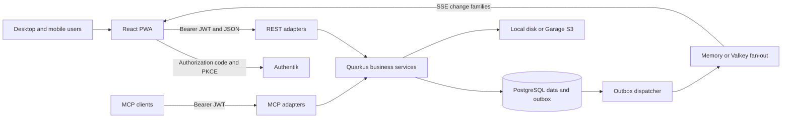

# Technical Requirements

This document owns the runtime stack, component boundaries and engineering constraints. Product behavior belongs in [Product Requirements](PRODUCT_REQUIREMENTS.md), persistence in [Database Schema and Data Storage](DATABASE_SCHEMA.md), and remaining work in [Implementation Plan and Progress](IMPLEMENTATION_PLAN.md). Versions below are declarations in this repository, not claims about the latest upstream releases.

## 1. System structure

ASH Inventory is a React PWA backed by a Quarkus modular monolith. REST, MCP and offline replay call the same business services. Inventory, allocation, custody, returns and lifecycle changes share PostgreSQL transactions; there is no separate inventory microservice or client-authoritative stock engine.



## 2. Frontend framework requirements

Source: [package.json](../package.json), [Vite configuration](../vite.config.ts), [App](../src/App.tsx).

| Concern | Current dependency or implementation | Requirement / target |
|---|---|---|
| Runtime | React / React DOM `^19.3.0`; React Compiler `^1.0.0` | Use the compiler; avoid redundant manual memoization |
| Tooling | Bun with `bun.lock`; Vite `^8.3.2`, React plugin `^6.1.1` | Bun manages frontend dependencies and scripts |
| Language | TypeScript `~6.0.3`; `typescript-native` aliases TypeScript `~7.0.2` | TS 7 performs build typechecking; TS 6 supports lint tooling |
| UI | MUI Material/icons `^9.4.0`, DataGrid `^9.14.0`, Emotion `^11.14.x` | Reuse theme and shared controls; see [Design Brief](DESIGN_BRIEF.md) |
| Server state | TanStack React Query `^5.104.1` | Session-scoped QueryClient; selective query invalidation |
| UI state | Zustand `^5.0.15` | Keep UI preferences separate from server state |
| Routing | React Router DOM `^7.18.4`, BrowserRouter, lazy Routes | Data router / loaders remain planned, PLAN-08 |
| Localization | i18next `^26.4.2`, German and English | Key-only translations remain planned, PLAN-09 |
| Maps | Leaflet `^1.9.4`, React Leaflet `^5.0.0` | Location hierarchy, geographic position and overlays |
| Charts | Recharts `^3.10.1` | Dashboard / reporting presentation |
| Labels and exports | qrcode `^1.5.4`, jsPDF `^4.2.1` | Generate labels and PDFs; import heavy exports on demand |
| Authentication | Custom `oidcClient.ts`, `authManager.ts`, durable session storage | `oidc-client-ts` / `react-oidc-context` are targets, PLAN-05 |
| API contracts | Handwritten types, `apiClient.ts`, capability-based `resourceFactory.ts` | OpenAPI-generated `openapi-typescript` / `openapi-fetch` are targets, PLAN-04 |
| Offline | Custom IndexedDB cache, queue, history and conflict handling | Query persistence and persisted paused mutations are targets, PLAN-06 |
| Forms | Component field state and shared dialogs | react-hook-form and zod are targets, PLAN-07 |
| Lint | ESLint `^10.11.0`, TypeScript ESLint `^8.71.0`, React hooks `^7.1.1` | Apply TypeScript and React Compiler lint rules |

Target libraries are **not installed requirements of the current app**. Their adoption must retain existing behavior and privacy guarantees.

Frontend ownership:

```text
pages/       route composition and screen orchestration
components/  shared controls, forms, dialogs, tables and workflow sections
hooks/       query and mutation bindings
services/    transport, contracts, authentication, offline persistence
types/       API/domain types
utils/       calculations, code resolution, formatting and access UX
store/       Zustand UI state
i18n/        language resources
```

Pages delegate transport to services. Stock displayed by the client comes from the API projection. UI access checks improve navigation; backend checks authorize commands. `useProgressiveList` currently fetches successive pages automatically, so backend paging does not yet make every screen server-paged (PLAN-03).

## 3. Backend framework requirements

Source: [Maven project](../backend/pom.xml), [runtime configuration](../backend/src/main/resources/application.properties).

| Concern | Current implementation |
|---|---|
| Language/build | Java 25, Maven, Quarkus platform `3.39.5` |
| DI / HTTP / JSON | Quarkus Arc, REST Jackson, Hibernate Validator |
| Persistence | Hibernate ORM and PostgreSQL JDBC; custom ORM collaborators, no Panache dependency |
| Schema initialization | Flyway with PostgreSQL support; single editable baseline; Hibernate `validate` |
| Authentication | Quarkus OIDC service mode; bearer JWTs; Authentik groups |
| API discovery | SmallRye OpenAPI; development Swagger UI |
| Operations | SmallRye Health, scheduler, optional OpenTelemetry export |
| Reference caching | Quarkus Cache / Caffeine, committed revision keys |
| Cluster support | Quarkus Redis client communicating with Valkey |
| Media | Quarkus Amazon S3, AWS SDK URL connection client, or local filesystem |
| AI integration | `quarkus-mcp-server-http:2.0.1`; 21 tools, 3 resources, 2 prompts |
| Verification libraries | Quarkus JUnit and REST Assured; configured tests use PostgreSQL |

The POM still declares H2 in test/development dependencies. `application.properties` selects PostgreSQL for the actual schema/test path; H2 is not the documented production or acceptance database.

```text
resource/  HTTP routes, validation, explicit DTO mapping and status codes
service/   use cases, authorization, transactions, invariants, domain events
orm/       queries, locks, paging and batch fact loaders
model/     JPA entities and enums; no active-record API
helper/    security, media, events, rate limiting, business time and utilities
mcp/       MCP adapters calling services
```

## 4. Command, consistency and API contracts

Stock-affecting operations must authenticate/authorize, deduplicate the command UUID, lock relevant state, validate current stock/lifecycle, update ledger and projections, append audit/outbox evidence, then commit once. Replay is atomic per command. Cached availability cannot authorize a command.

Use explicit request and response records in `ApiModels`, `ApiResponses` and `ApiMapper`; never serialize entities. Expected responses: 400 invalid input, 403 insufficient rights, 404 absent or invisible resource, 409 conflicting state. Supported list endpoints accept bounded paging/filtering/search. Privacy-shortened pages advertise `X-Filtered-Rows` so clients do not treat them as complete.

The outbox is written in the business transaction. After commit, dispatch is woken locally; a default 5-second poll handles other nodes and recovery. Rows are claimed under a lease with `SKIP LOCKED`. Delivery is at least once, consumers deduplicate by event ID, 10 failed attempts cause dead letter, and published events default to 30-day retention. Operator retries require authorization.

SSE sends change families and catalog resource kind, without IDs, actors, quantities or event payloads. The stream ends at token expiry. The frontend coalesces invalidations for 300 ms; reconnect and `access.changed` reset private inventory queries and private media references. SSE is a refresh signal, not a durable client ledger.

Domain event families include `catalog.*`, `stock.*`, `asset.*`, `order.*`, `general_order.*`, `custody.*`, `return.*`, `damage.*`, `repair.*`, `maintenance.*`, `transfer.*`, `count.*`, `purchase_order.*`, `goods_receipt.*`, `loan.*`, `equipment.*`, `access.changed` and `user.changed`. Adapters expose refresh classifications rather than raw outbox payloads.

## 5. Identity and privacy requirements

- Browser login uses authorization code + PKCE. API bearer audience must match its configured OIDC client ID. Account identity is `(issuer, sub)`, not display name or email.
- Roles come from `inventory_<role>` groups; faction membership comes from `inventory_faction_<EVENT>_<slug>`, yielding `EVENT:slug`. No recognized inventory role means 403. User management displays provider-owned roles.
- Logout attempts access/refresh-token revocation, cross-tab logout and provider end-session. Local JWT validation continues to accept a revoked token until `exp`; optional `OIDC_REQUIRE_INTROSPECTION` bounds this by the provider/cache behavior. Immediate logout enforcement is therefore an acceptance/configuration task (ACC-01).
- Production startup rejects development header authentication or disabled OIDC. Production `/api/*`, `/mcp` and `/mcp/*` require authentication.
- Private policy owners and HQ admins have implicit access; other roles require resource-specific grants. View, edit, share management and stock operation rights differ. Private location data may remain restricted even when the item is visible.
- Permissions are checked again on replay. Private writes and uploads remain online-only. Private projections are excluded from durable offline catalog caching.
- API/media responses use private/no-store controls. Policy edits use revisions and audited before/after evidence. The current response/reference-graph privacy mechanism remains alongside query scoping; PLAN-01 tracks its planned simplification.
- Upload defaults: signature-sniffed WebP/PNG/JPEG/PDF, 10 MiB per file, 50 staged uploads per user, purge unattached media after 24 hours. Media is bound to a resource and authorized on download.

## 6. PWA and runtime requirements

[Service worker](../public/sw.js) caches the app shell and same-origin assets. Navigation/config use network first; hashed bundles use cache first. `/api/` and third-party resources are excluded. Vite stamps a build-specific cache version. Maps and media are not promised offline; previously downloaded organizational catalog data is available through the IndexedDB reader.

Runtime browser settings are supplied through `config.js`; server settings use environment variables. Business calendar dates use `INVENTORY_TIMEZONE`, default Europe/Berlin. Telemetry (traces) export is disabled by default and enabled through `OTEL_SDK_DISABLED=false`; see §7.

| Deployment | Checked-in composition | Acceptance boundary |
|---|---|---|
| Single node | PostgreSQL 18, one API, nginx PWA; memory events/rate limiting; local media or Garage 2.3.0 | Default application topology; operator setup and recovery remain environment work |
| Cluster | Two API replicas, shared PostgreSQL, Garage and Valkey 8; Redis protocol for events/rate limiting | One Docker network is described; separate hosts need explicit reachable endpoints |
| Storage node | Traefik 3.7.12, Garage, logical PostgreSQL replica, monitoring | Logical publication/subscription and off-site backup are operator procedures |

Compose files are templates, not proof of provisioned infrastructure. Multiple API replicas do not supply automatic PostgreSQL failover. Cloudflare routing, WAL archiving, restore times and load capacity in deployment docs are proposals, not measured guarantees.

nginx generates CSP connect origins from configured API/OIDC URLs and enables same-origin camera use. Proxy forwarding trusts explicitly configured proxies. PostgreSQL and media must be backed up as one recovery unit. Details: [Step 1](DEPLOYMENT_STEP1.md), [Step 2](DEPLOYMENT_STEP2.md), [logical replication](postgres-logical-replication.md).

## 7. Observability

The API can export OpenTelemetry **traces** to [OpenObserve](https://openobserve.ai/). Export is off by default (`OTEL_SDK_DISABLED=true`).

### What is exported

| Signal | Status | Notes |
|---|---|---|
| Traces | Exported when enabled | HTTP server spans and instrumented outgoing calls; `service.name=ash-inventory-api`. JDBC spans would need `quarkus.datasource.jdbc.telemetry=true` (build time, not set) |
| Metrics | Not exported | `quarkus.otel.metrics.enabled` is a build-time property and is not set; the metrics exporter protocol in `application.properties` is prepared but inactive |
| Logs | Not exported | Container stdout only (`docker compose logs inventory-api`) |
| Browser RUM | Not used | The PWA does not ship the OpenObserve RUM SDK, and its CSP `connect-src` only allows the API and OIDC origins |

Both API nodes in the cluster template use the same `service.name`; distinguish them by host attributes in OpenObserve.

### OpenObserve container

OpenObserve runs outside this repository's Compose files, on a shared external Docker network that the reverse proxy also uses:

```yaml
openobserve:
  image: public.ecr.aws/zinclabs/openobserve-enterprise:v1.0.4
  container_name: openobserve
  restart: unless-stopped
  environment:
    - ZO_ROOT_USER_EMAIL=${ZO_ROOT_USER_EMAIL}
    - ZO_ROOT_USER_PASSWORD=${ZO_ROOT_USER_PASSWORD}
    - ZO_RUM_ENABLED=true
    - ZO_RUM_CLIENT_TOKEN=${ZO_RUM_CLIENT_TOKEN}
    - ZO_CORS_ALLOWED_ORIGINS=https://inventory.example.com
  volumes:
    - /home/docker/data/openobserve_data:/data
  networks:
    - proxy_network
```

No port is published; the UI and ingestion API (port 5080) are reached through the reverse proxy or from containers on `proxy_network`. The RUM and CORS settings serve other web apps using the same instance; this API sends OTLP from the server and needs neither.

### Connecting the API

1. In OpenObserve, open **Ingestion → OpenTelemetry** for the target organization (default: `default`) and copy the Basic-auth token. It is `base64("email:password")` of an ingestion user.
2. Pick one route to OpenObserve.

   **Same host, shared Docker network.** Add a `docker-compose.override.yml` next to `docker-compose.yml` so the API joins `proxy_network`:

   ```yaml
   services:
     inventory-api:
       networks: [default, proxy_network]
   networks:
     proxy_network:
       external: true
   ```

   The default endpoint `http://openobserve:5080/api/default` then resolves by container name. For the cluster template, add the same `networks` entry to `inventory-api-1` (and to `inventory-api-2` if it runs on the same host).

   **Other host.** Use OpenObserve's public URL through the reverse proxy, e.g. `OTEL_EXPORTER_OTLP_ENDPOINT=https://observe.example.com/api/default`.

3. Set in `.env`:

   ```dotenv
   OTEL_SDK_DISABLED=false
   OTEL_EXPORTER_OTLP_ENDPOINT=http://openobserve:5080/api/default
   OTEL_EXPORTER_OTLP_TOKEN=<base64 email:password>
   ```

4. Restart the API. Traces appear under **Traces** with service `ash-inventory-api`.

The exporter uses OTLP over HTTP/protobuf (`/v1/traces` is appended to the endpoint); OpenObserve's gRPC port is not used. If nothing arrives, set `OTEL_LOG_LEVEL=DEBUG` and check the API log for exporter `401` (wrong token) or `404` (wrong organization path).

### Not yet covered

No alerts are configured for outbox dead letters, sync conflicts, replication lag or retained WAL on the logical replication slot. These are visible only in the app's System tab and with the SQL queries in [PostgreSQL logical replication](postgres-logical-replication.md). Tracked as OBS-01 in [Implementation Plan and Progress](IMPLEMENTATION_PLAN.md).

## 8. Engineering acceptance

The repository requires direct changes to current contracts and the editable schema baseline: disposable data, no compatibility adapters or incremental migration files. Builds and application tests run only when explicitly authorized by [agent.md](../agent.md).

The pending Authentik, browser/mobile, S3, load, restore and cluster checks are tracked in [Implementation Plan and Progress](IMPLEMENTATION_PLAN.md).
